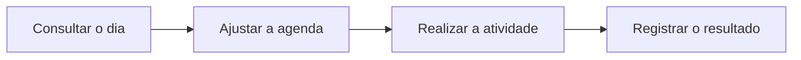

<div align="center">

# Kaizen

**Seu treino de hoje. Seu progresso ao longo do tempo.**

Um aplicativo pessoal para organizar treinos, registrar o que foi realizado e,
futuramente, acompanhar a alimentação na mesma rotina.

[Funcionalidades](#o-que-já-dá-para-fazer) · [Como funciona](#uma-jornada-no-kaizen) · [Rodar localmente](#rodar-localmente) · [Documentação](#documentação)

</div>

---

## Por que o Kaizen existe?

Consultar uma ficha de treino é só uma parte da rotina. Também é preciso saber
o que está previsto para hoje, ajustar a agenda e guardar o que aconteceu de
verdade: séries realizadas, mudanças e atividades praticadas fora da academia.

O Kaizen reúne essas etapas em um lugar, com foco inicial no uso pessoal.
O planejamento orienta o dia; os registros contam como ele aconteceu.

## O que já dá para fazer

| Na sua rotina                    | No Kaizen                                                                                                               |
| -------------------------------- | ----------------------------------------------------------------------------------------------------------------------- |
| **Consultar o dia**              | Ver as atividades da data e a ficha de treino correspondente.                                                           |
| **Organizar a agenda**           | Adicionar, editar ou remover atividades entre ontem e os próximos quatro dias, respeitando as regras de cada atividade. |
| **Executar o treino**            | Consultar a preparação e os exercícios e registrar séries, cargas, repetições e comentários.                            |
| **Registrar uma prática depois** | Registrar futevôlei e atividades externas de hoje ou ontem sem precisar iniciar um cronômetro.                          |
| **Preservar o contexto**         | Manter os registros associados à data e à versão do plano usada naquele momento.                                        |

> **Planejar e realizar são etapas diferentes.** Você pode organizar os próximos
> dias, mas registrar ou iniciar uma execução futura continua bloqueado.

## Uma jornada no Kaizen



1. **Abra Treino e confira o dia.** Consulte as atividades previstas e expanda
   uma delas para ver seus detalhes.
2. **Ajuste o planejamento quando necessário.** Organize as atividades dentro
   da janela permitida, inclusive para os próximos dias.
3. **Registre o que aconteceu.** No treino com exercícios, informe os resultados
   das séries. Para uma prática externa de hoje ou ontem, use o registro direto.
4. **Mantenha o resultado ligado ao plano.** O registro preserva sua data e a
   referência do plano, mesmo que a programação mude depois.

**Exemplo ilustrativo:** você jogou futevôlei ontem e não abriu o aplicativo na
hora. Hoje, pode acessar a data de ontem e registrar a prática, sem inventar
horários ou executar um cronômetro retroativamente.

## Em que etapa está o projeto?

O Kaizen está em desenvolvimento. A área de treino já possui consulta e registro
com dados persistidos em PostgreSQL; a experiência completa continua em validação.

| Área                     | Situação atual                                                                                                 |
| ------------------------ | -------------------------------------------------------------------------------------------------------------- |
| **Treino**               | Consulta do dia, agenda, exercícios e registro implementados.                                                  |
| **Atividades externas**  | Registro retrospectivo implementado; jornada manual completa ainda pendente na E06-T23.                        |
| **Alimentação**          | Planos versionados no repositório; a tela ainda é uma estrutura inicial, sem registro de refeições.            |
| **Navegação no celular** | Barra inferior implementada; teclado virtual e área segura da tela ainda exigem validação em dispositivo real. |
| **Evolução visual**      | Plano de adoção visual documentado, aguardando aprovação para implementação.                                   |

Sono, atividades gerais, recursos de progressão e outros avanços estão no
[roadmap](roadmap/README.md). Sua presença no planejamento não significa que
estejam disponíveis no aplicativo.

## Acesso e privacidade

> **A versão atual funciona sem login.** Quem acessar a URL pode consultar e
> alterar os registros pelas operações disponíveis. Existe um único espaço de
> dados compartilhado, configurado no servidor.

Essa é uma decisão temporária para esta fase pessoal do projeto. Autenticação
é obrigatória antes de atender múltiplos usuários ou armazenar dados sensíveis.
A decisão completa está em [Modo público com workspace único](docs/decisions/PUBLIC-SINGLE-WORKSPACE-MODE.md).

O código e os planos aprovados são versionados neste repositório público.
Credenciais, configurações locais, backups e registros do banco não devem ser
commitados. Os planos documentam o uso pessoal e não substituem orientação
profissional de treino ou alimentação.

## Rodar localmente

O desenvolvimento usa **Node.js 24.20.0**, **pnpm 11.25.0** e **PostgreSQL**.
O banco local pode ser iniciado com Docker Compose.

<details>
<summary><strong>Primeira configuração do ambiente</strong></summary>

### 1. Preparar dependências e configuração

Na raiz do repositório, habilite o gerenciador e instale as dependências:

```powershell
corepack enable
pnpm install --frozen-lockfile
```

O pacote visual `@fradelli/ui` vem do GitHub Packages. A instalação depende de
acesso de leitura a esse registry; mantenha credenciais fora do repositório.

Se ainda não houver um `.env`, copie [.env.example](.env.example) para esse nome.
Preencha as senhas locais e as conexões de desenvolvimento, teste e recuperação
conforme os comentários do exemplo. Não sobrescreva uma configuração existente.

### 2. Preparar o banco local

Com o Docker em execução e as variáveis configuradas:

```powershell
docker compose up -d --wait database
pnpm db:generate
pnpm db:deploy
pnpm workspace:ensure
```

Use um banco de desenvolvimento. `db:deploy` aplica as migrations versionadas;
`workspace:ensure` prepara o espaço único de dados usado pela aplicação.

### 3. Importar os planos e abrir o aplicativo

Em um banco local novo, importe as definições versionadas:

```powershell
pnpm data:import --environment local
pnpm dev
```

A importação usa, por padrão, os arquivos do commit `HEAD`, e não alterações
pendentes. Confira o resultado do importador; detalhes de importação e ativação
estão no [guia de persistência](docs/implementation/E05.md).

Abra [Treino no ambiente local](http://localhost:3000/treino).

</details>

<details>
<summary><strong>Ambiente já preparado e acesso pelo celular</strong></summary>

Para iniciar novamente:

```powershell
pnpm dev
```

Para testar em um celular na mesma rede, pare o servidor e substitua `IP_LOCAL`
pelo endereço da máquina de desenvolvimento:

```powershell
pnpm db:generate
pnpm workspace:ensure
pnpm exec next dev --hostname IP_LOCAL
```

No celular, abra `http://IP_LOCAL:3000/treino`, usando o mesmo endereço do comando.
O acesso pela rede também segue o modo sem login descrito acima.

</details>

## Para quem desenvolve

A aplicação usa Next.js com React e TypeScript. Os planos ficam em JSON
versionado; atribuições e execuções ficam em PostgreSQL, com Prisma. A interface
consome o Fradelli Design System.

| Comando                 | Finalidade                                                                                                         |
| ----------------------- | ------------------------------------------------------------------------------------------------------------------ |
| `pnpm dev`              | Iniciar o ambiente de desenvolvimento.                                                                             |
| `pnpm data:check`       | Conferir os dados versionados, seus IDs e referências.                                                             |
| `pnpm test`             | Executar os testes unitários.                                                                                      |
| `pnpm test:integration` | Executar os testes que dependem do banco de teste configurado.                                                     |
| `pnpm run ci`           | Executar os gates locais de qualidade, testes, dados, build e auditoria; exige os ambientes de teste configurados. |

Os scripts completos estão em [package.json](package.json). `pnpm run ci` é o
comando de validação do projeto; `pnpm ci` é reservado à instalação congelada.

<details>
<summary><strong>Organização do repositório e fluxo de entrega</strong></summary>

| Caminho              | O que você encontra                                                    |
| -------------------- | ---------------------------------------------------------------------- |
| `src/`               | Aplicação e regras de negócio.                                         |
| `data/` e `schemas/` | Planos versionados e contratos de validação.                           |
| `prisma/`            | Modelo do banco e migrations.                                          |
| `tests/`             | Testes e cenários de integração.                                       |
| `docs/`              | Produto, arquitetura, decisões e guias.                                |
| `roadmap/`           | Tarefas, dependências e estado das entregas.                           |
| `vendor/braces/`     | Código versionado de uma correção de dependência; deve ser preservado. |

`node_modules/` contém dependências instaladas. `.next/`, `coverage/` e
`*.tsbuildinfo` são gerados e podem ser recriados. O `.env` contém a configuração
local e deve permanecer fora do Git.

Cópias de trabalho do Git são auxiliares. Antes de removê-las, preserve qualquer
alteração local em um commit ou backup recuperável.

O fluxo de entrega é `branch de tarefa → developer → staging → master`.
Tarefas entram em `developer` por squash; promoções usam merge commit.
As convenções completas estão em [AGENTS.md](AGENTS.md).

</details>

## Documentação

| Quero entender…                           | Onde consultar                                                                         |
| ----------------------------------------- | -------------------------------------------------------------------------------------- |
| Qual é a próxima pendência                | [Tarefa selecionada](roadmap/ACTIVE.md)                                                |
| O que foi entregue e o que está planejado | [Roadmap](roadmap/README.md)                                                           |
| Como o produto deve funcionar             | [Escopo e jornadas do P0](docs/product/P0.md)                                          |
| Como a aplicação é organizada             | [Arquitetura alvo](docs/architecture/TARGET-ARCHITECTURE.md)                           |
| Como os dados públicos são tratados       | [Política do repositório público](docs/decisions/PUBLIC-REPOSITORY-AND-DATA-POLICY.md) |
| Quais planos estão selecionados           | [Treino](data/active.json) e [alimentação](data/nutrition/active.json)                 |
| Como a aparência pode evoluir             | [Proposta visual](docs/implementation/FRADELLI-DESIGN-SYSTEM-ADOPTION-PLAN.md)         |

O [contexto consolidado](kaizen-project-context.md) preserva uma análise histórica;
confirme informações de implementação no código e no roadmap atual.
