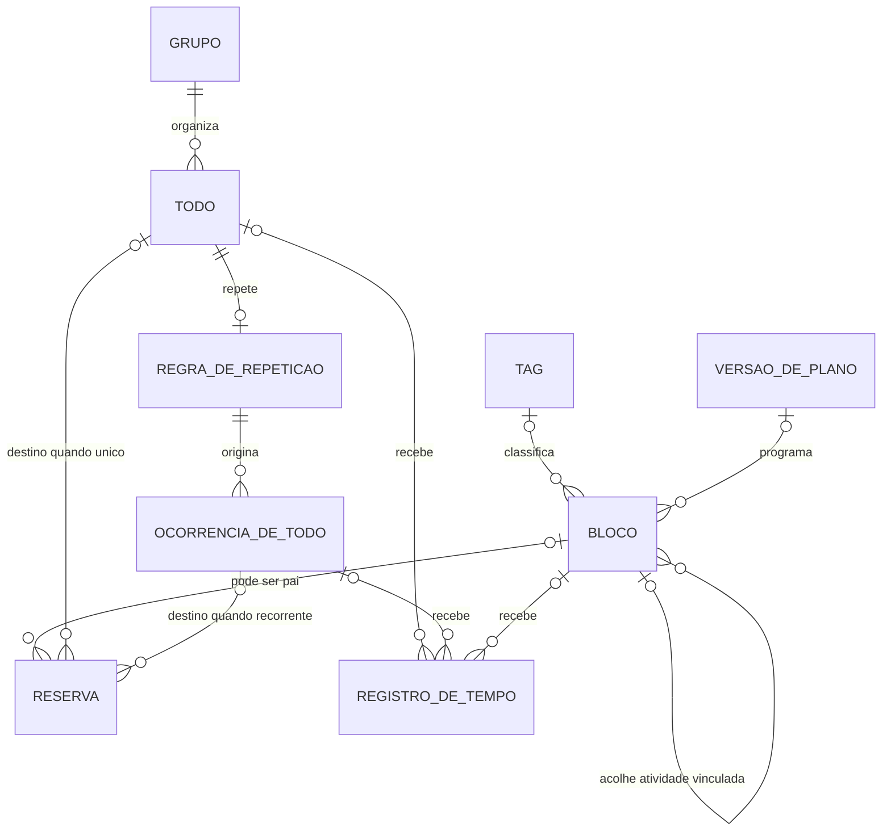

# Modelo conceitual da agenda

Proposta para revisão de produto em 17/11/2026. Parte das [regras da agenda](../product/telas/agenda-regras-de-produto.md), das decisões R01–R05 da especificação consolidada de 16/11 e da decisão posterior sobre a grade de 15 minutos. Os nomes representam conceitos do produto. O desenho físico das tabelas e a comparação com o sistema atual vêm depois da aprovação.

## Relações

Cada reserva pode manter um bloco pai mesmo quando aparece fora dele e tem **exatamente um destino de tarefa**: um to-do único ou uma ocorrência de to-do recorrente. Cada registro de tempo também tem **um único destino** entre os três representados. As alternativas do diagrama são mutuamente exclusivas. Uma tarefa livre e uma ocorrência de leitura podem existir sem nenhuma reserva.

| Conceito | O que precisa permanecer identificável |
|---|---|
| Grupo e tag | O grupo pertence à organização da lista. A tag principal do bloco é opcional e define sua cor. Reservar Matemática em Trabalho conserva o grupo original. |
| To-do único | Guarda a conclusão compartilhada por todas as suas reservas. Uma tarefa concluída pode continuar com horários futuros. |
| Regra e ocorrência de to-do | A regra define os dias previstos. A ocorrência guarda a conclusão ou o cancelamento daquela repetição e conserva a origem ao ser remarcada. Duas ocorrências podem acabar na mesma data. |
| Bloco | Intervalo próprio que pode estar vazio, atravessar a meia-noite ou durar vários dias. Todas as fatias visíveis na grade remetem ao mesmo bloco. |
| Origem do bloco | Pode ser avulso ou projetado a partir de uma programação de plano vigente. Para uma ocorrência de plano, distinguir o item prescrito e a ocorrência original da versão usada e do horário atual. O vínculo funcional determina a abertura do treino ou da dieta. |
| Reserva | Período planejado do to-do dentro do bloco. Tem identidade própria para permitir mover ou remover só um dos horários. |
| Registro de tempo | Duração real informada, inclusive quando o to-do segue pendente ou já perdeu a reserva. Em bloco com tarefas, atribuir o tempo delas às tarefas. Um bloco vazio pode receber tempo próprio. |

A posição da reserva e sua cor seguem as [regras de vínculo e troca de lista](../product/telas/agenda-regras-de-produto.md#reserva-de-to-do-fora-do-horário-do-pai). O horário por si só não determina o pai.

## Operações e efeitos

Uma atividade com data pode existir sem intervalo horário. Ela pertence à faixa superior do dia. Para uma atividade com intervalo, o vínculo opcional com outra atividade altera a apresentação e o tratamento de uma mudança de horário do bloco pai. As duas usam o mesmo modelo de atividade. Ver a [regra do diálogo de reajuste](../product/telas/agenda-regras-de-produto.md#alterar-o-início-de-uma-atividade-com-outras-atividades-dentro).

Uma ocorrência de atividade comum pode pertencer a um bloco pai. O vínculo ocupa tempo dentro desse bloco e pode ser removido preservando a identidade da atividade. A reserva de to-do continua sendo uma relação separada. A interação e o critério de aceite estão nas [regras de arraste da agenda](../product/telas/agenda-regras-de-produto.md#arrastar-uma-atividade-comum-para-dentro-ou-para-o-lado).

| Ação | O que muda ao confirmar | Comportamento observável |
|---|---|---|
| Criar to-do na lista | Surge uma tarefa em seu grupo. | Pode continuar sem horário. |
| Reservar em um bloco | Acrescenta uma reserva ao destino escolhido. A prévia usa a estimativa ou 30 min e termina no limite livre contínuo. | Início e fim em :00, :15, :30 ou :45. Início ocupado por reserva irmã gera erro e preserva os dados. Outro bloco no mesmo horário é permitido. |
| Reservar em área livre ou sobre +N | Em área livre, confirmar cria bloco e reserva juntos. Sobre +N, escolher primeiro o bloco. | Cancelar a prévia conserva a tarefa e descarta todas as mudanças propostas. |
| Concluir | Atualiza o checkbox do to-do único ou da ocorrência selecionada. | Lista e cards concordam. Reservas futuras continuam e podem ser removidas por escolha explícita. Tempo real segue independente. |
| Desagendar | Retira somente a reserva selecionada. | A tarefa, o checkbox, as demais reservas e os registros reais permanecem. |
| Remarcar uma reserva | Troca bloco ou intervalo daquela reserva após validar o destino e o espaço livre. | Preserva grupo, tarefa e conclusão. Se o destino estiver ocupado, o horário original continua válido. |
| Remarcar uma ocorrência recorrente | “Somente esta” cria uma exceção preservando a identidade de origem. “Esta e as próximas” altera a programação a partir da ocorrência escolhida. | O passado e as exceções futuras personalizadas são preservados por padrão. Reservas que precisariam de ajuste exigem tratamento explícito. |
| Cancelar ocorrência ou encerrar repetição | Cancelar alcança uma ocorrência. Encerrar impede novas ocorrências da série. | O histórico distingue cancelamento intencional, conclusão e ausência de registro. Repetir um bloco não replica suas tarefas. |
| Encurtar o fim do bloco | Validar as reservas antes de cortar o intervalo. | Se cortar uma reserva, o usuário deve ajustá-la antes. |
| Excluir bloco | Aplicar a escolha de manter ou remover os itens da agenda, incluindo os vinculados fora do intervalo. | Preservar o to-do, o checkbox e o histórico. Ver os [diálogos aprovados](../product/telas/agenda-regras-de-produto.md#diálogos-de-exclusão-e-movimento). |
| Registrar duração real | Acrescenta duração ao destino escolhido. | Uma reserva de 30 min aceita 42 min reais. O checkbox e os horários planejados permanecem como estavam. |

Uma consulta semanal combina programação vigente, atividades avulsas e exceções. Um futuro idêntico ao plano pode ser projetado na leitura. A passagem do tempo preserva o que estava programado no histórico, sem declarar execução. Uma alteração pontual deve encontrar a ocorrência mesmo depois de sua remarcação. Esse requisito também vale para correções intencionais no passado.

## Validação do desenho por exemplos

**1. Resolver lista 3.** Criar o to-do no grupo Matemática. Reservar segunda às 8h no bloco das 6h às 12h gera a prévia 8h–8h30. Criar uma segunda reserva na quarta e informar 42 min reais na segunda. Ao concluir na terça, ambas as representações exibem o mesmo checkbox. Remover a reserva de quarta conserva a reserva de segunda e os 42 min. Resultado esperado: uma tarefa concluída, uma reserva restante e um único registro real.

**2. Ler diariamente.** Reservar segunda às 7h e às 20h para a mesma ocorrência. Concluir por qualquer um dos dois cards marca a segunda. A terça continua independente. Remarcar a ocorrência de terça para quarta preserva duas identidades nessa data: a leitura originalmente de terça e a prevista para quarta. Concluir uma delas deixa o checkbox da outra intacto.

**3. Conferir limites e totais.** Uma tarefa sem estimativa solta às 11h45 em um bloco que termina às 12h recebe 15 min. Para dois blocos sobrepostos, 14h–17h e 14h–15h, o total das durações dos blocos é 4h e a ocupação distinta é 3h. Se nenhum registro real foi informado, o tempo executado é desconhecido. Um relatório agrupado por bloco e por tarefa deve contar cada registro real uma única vez no total.

## Pontos para revisão antes da persistência

- Ao remarcar uma ocorrência que já tem várias reservas, falta definir quais horários propor mover e como resolver conflitos. O usuário precisa poder cancelar antes de afetar as reservas.
- A UX de reabertura, a retenção após exclusão definitiva e a reatribuição de tempo real entre bloco e tarefas continuam abertas. Para tarefas com histórico, o fluxo principal previsto é arquivar.
- Um bloco criado a partir de um grupo em área livre pode ficar sem tag. A eventual sugestão automática de tag e a persistência da associação entre bloco e grupo ainda precisam de decisão.

Após revisar essas relações, comparar o modelo com os contratos, leituras, gravações e testes existentes. O primeiro percurso a validar na aplicação é criar na lista, reservar, recarregar, concluir pelo card e conferir a lista, antes de acrescentar o gesto de arrastar.
